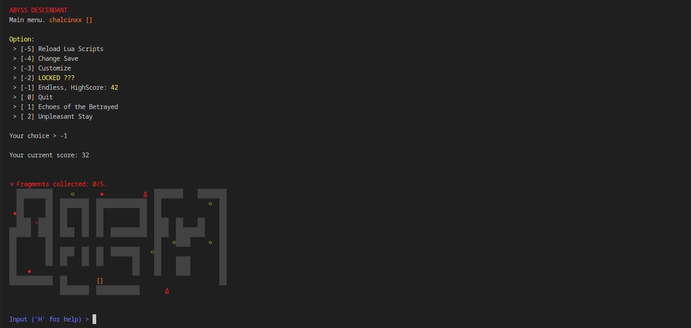

# Abyss Ascendant
This project contains the Abyss Ascendant game's source-code, the level data and the level editor. The level editor can be found in `editor` folder and is made with pure HTML/CSS/JS. It can be hosted easily. The `script` folder contains all of the game data in Lua, including levels, story and endless mode. All variables are found in [script/variables.lua](script/variables.lua). The game itself is made with C++ and saves data with SQLite3.



The game is a story-driven CLI ASCII game. It is based on Abyss Ascendant's story.

## Building
This project depends on C++20, [Lua5.1](https://lua.org/), [SQLite3](https://www.sqlite.org/) and [SFML2.6](https://www.sfml-dev.org/). The preferred way of building is using CMake:
```bash
cmake -B build
cmake --build build
```
The executable will be located in `build/aa`. The sounds and scripts folders must be in the same directory in which the executable is ran.

## Credits
This project was made by Daniel Vishnevsky and is licensed under MIT License. it was made in September of 2024 and published on October 2026 as an effort to make all of my projects open-source.
